# playbooks

Configuration and reference notes for [mr-robot](https://github.com/ry-ops/mr-robot), the ADR-driven HackTheBox co-pilot. Keeping them here means mr-robot's behavior can be tuned by editing files, not code.

## Layout

- **[`htb-default.yaml`](htb-default.yaml):** the default unlock playbook. mr-robot loads it to decide which tasks to add to the board as work progresses.
- **[`skills/`](skills/):** reference notes, grouped by topic:

| Folder | Notes |
|---|--:|
| [`analysis/`](skills/analysis/) | 4 |
| [`cloud/`](skills/cloud/) | 4 |
| [`frameworks/`](skills/frameworks/) | 4 |
| [`protocols/`](skills/protocols/) | 2 |
| [`reconnaissance/`](skills/reconnaissance/) | 2 |
| [`technologies/`](skills/technologies/) | 7 |
| [`tooling/`](skills/tooling/) | 10 |
| [`vulnerabilities/`](skills/vulnerabilities/) | 29 |

This repo is private and only used by mr-robot.

<!-- org-footer -->
---

Part of <a href="https://github.com/ry-ops">ry-ops</a> · building the pipes between infrastructure, automation, and observability · built by <a href="https://github.com/ry-ops">ry-ops</a>

