<p align="center">
  
</p>

<h1 align="center">playbooks</h1>

<p align="center"><b>Declarative YAML that drives <a href="https://github.com/ry-ops/mr-robot">mr-robot</a>.</b> The unlock playbook and reference notes for the ADR-driven HackTheBox co-pilot — so its behavior can be tuned by editing files, not code.</p>

<p align="center">
  
  
  
  
</p>

---

## What this is

mr-robot is an orchestrator; this repo is its **brain-as-config**. Change how it approaches a box by editing YAML and markdown — no code changes, no redeploy.

- **[`htb-default.yaml`](htb-default.yaml)** — the default unlock playbook. mr-robot loads it to decide which tasks to add to the board as work progresses.
- **[`skills/`](skills/)** — 63 reference notes, grouped by topic, that tasks cite for methodology.

## The unlock lifecycle

The playbook is a small rule engine. It starts with **seed tasks**, then reacts to **findings** posted by the arcade:

```
seeds  →  finding posted  →  matching rule fires  →  task spawned
       →  task's depends_on satisfied  →  task goes `ready`
```

A rule matches on a finding's `type` (and optional field `match`), and `spawn`s one or more tasks. Each task carries a `priority` (0–100, higher wins), a `hat` (an ADR persona — white-hat, black-hat, …), advisory `tools`, the finding types it `produces` (which powers data-driven blocker resolution), and the `skills` it should consult:

```yaml
- id: web-service-to-web-enum
  when:
    type: service
    match: { service: [http, https, http-alt] }
  spawn:
    - task: enum.web.content
      summary: "Directory & content discovery on {data.url}"
      priority: 75
      hat: white-hat
      tools: [feroxbuster, ffuf, whatweb]
      produces: [web_path]
      skills: [tooling/ffuf, tooling/katana, reconnaissance/asset_discovery]
```

String fields interpolate from the engagement (`{box_ip}`, `{box_name}`) and the triggering finding (`{data.<field>}`).

## The skills library

<p align="center">
  
</p>

| Folder | Notes | Covers |
|---|--:|---|
| [`vulnerabilities/`](skills/vulnerabilities/) | 29 | XSS, SSRF, RCE, IDOR, XXE, SQLi, SSTI, deserialization, prototype pollution, race conditions … |
| [`tooling/`](skills/tooling/) | 10 | nmap, nuclei, ffuf, sqlmap, httpx, katana, naabu, subfinder, semgrep, hurl |
| [`technologies/`](skills/technologies/) | 7 | Active Directory, Firebase, Supabase, Auth0, Electron, Grafana/Prometheus, LLM apps |
| [`analysis/`](skills/analysis/) | 4 | severity calibration, counterevidence, fix verification, source-aware discovery |
| [`cloud/`](skills/cloud/) | 4 | AWS, Azure, GCP, Kubernetes |
| [`frameworks/`](skills/frameworks/) | 4 | Django, FastAPI, NestJS, Next.js |
| [`protocols/`](skills/protocols/) | 2 | GraphQL, OAuth |
| [`reconnaissance/`](skills/reconnaissance/) | 2 | asset discovery, infrastructure lifecycle |
| [`taxonomy/`](skills/taxonomy/) | 1 | prompt-injection taxonomy |

Tasks reference skills by path (e.g. `tooling/nmap`), so the assigned Hat always has the right methodology to hand.

## Tuning

Want mr-robot to enumerate differently, prioritize a service, or add a new vuln playbook? Edit `htb-default.yaml` and the relevant `skills/` notes — the engine picks up the change on the next engagement. This repo is private and used only by mr-robot.

<!-- org-footer -->
---

<p align="center"><sub>Part of <a href="https://github.com/ry-ops">ry-ops</a> · building the pipes between infrastructure, automation, and observability · built by <a href="https://github.com/ry-ops">ry-ops</a></sub></p>
